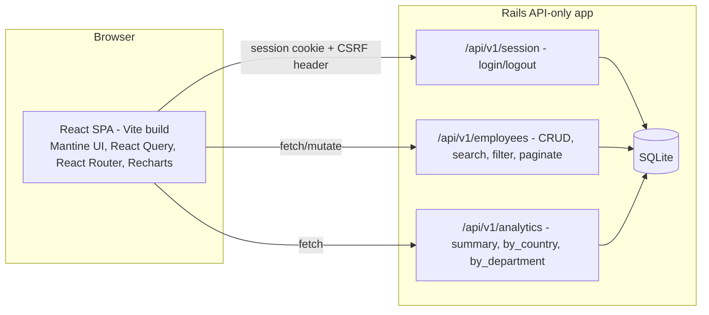
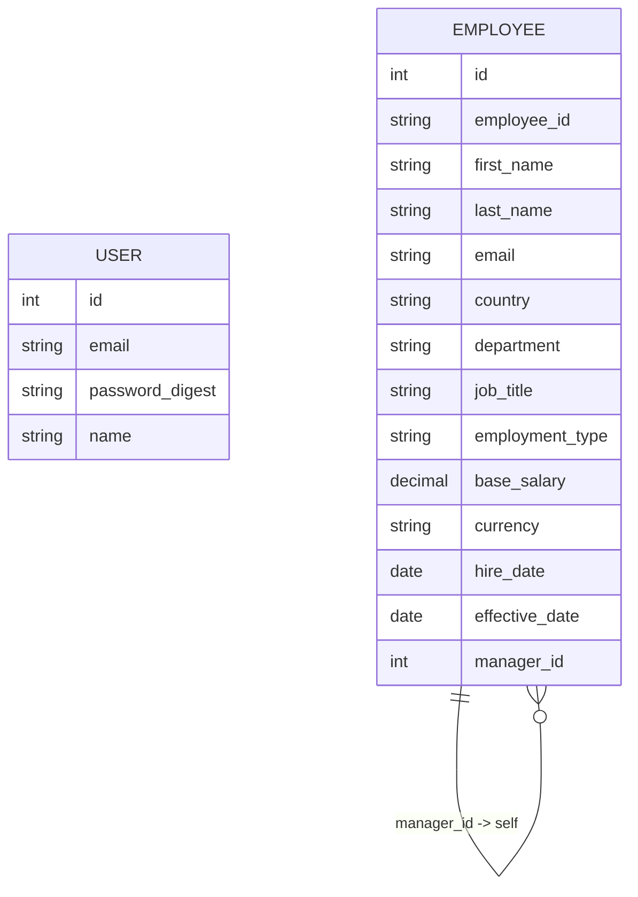

# Architecture

## System overview



In development the two halves run as separate processes (Rails on
`:3000`, Vite on `:5173`), with Vite's dev server proxying `/api/*` to
Rails so the frontend always calls relative paths. In production, Rails
serves the built React SPA itself from `public/` (same origin), with a
catch-all route (`StaticController`) handling client-side routes like
`/employees/42` on a full page load - see `backend/Dockerfile` and
`config/routes.rb`.

## Data model



- `base_salary` is `decimal(14,2)`, never `float` - avoids floating-point
  rounding error on money.
- `manager_id` is self-referential and nullable (senior employees have no
  manager). The model validates that it's never set to the employee's own
  id and always refers to an existing row - a database-level foreign key
  alone would surface as an unhandled `ActiveRecord::InvalidForeignKey`
  (a raw 500) rather than a clean validation error, so there's an explicit
  `manager_exists` check in `app/models/employee.rb`.
- Unique indexes on `employee_id` and `email`; plain indexes on `country`
  and `department` for filter/sort performance at 10,000 rows.

## Backend structure

```
app/controllers/api/v1/
  base_controller.rb        shared auth guard + consistent JSON error envelope
  sessions_controller.rb    login/logout/current-user check
  csrf_tokens_controller.rb issues the token the SPA attaches to mutations
  employees_controller.rb   CRUD + search/filter/sort/paginate
  analytics_controller.rb   summary / by_country / by_department
app/models/
  user.rb, employee.rb
app/services/
  analytics_service.rb      aggregation logic, kept out of the controller
lib/
  employee_seeder.rb        generates the 10,000-employee seed dataset
```

`BaseController` centralizes:
- the `require_authentication!` guard used by every protected controller
- `rescue_from` handlers for `ParameterMissing`, `RecordNotFound`,
  `InvalidForeignKey`, and a `StandardError` catch-all, so the API never
  returns a raw Rails error page or an inconsistent JSON shape. Rails
  resolves `rescue_from` by *most recently declared* handler, not most
  specific class, so `StandardError` is declared first and the specific
  handlers after it, deliberately, to make sure they take priority.

## Frontend structure

```
src/features/
  auth/         AuthContext, useAuth, LoginPage, ProtectedRoute
  employees/    list/detail/create/edit pages, employeesApi.js
  analytics/    BreakdownTable, HeadcountCharts, analyticsApi.js
  dashboard/    DashboardPage (summary cards, charts, breakdown tables)
src/lib/
  apiClient.js  fetch wrapper: CSRF token attachment + 401 handling
```

`apiClient.js` fetches the CSRF token once per session and attaches it
automatically to every mutating request (`POST`/`PATCH`/`PUT`/`DELETE`),
retrying once if the cached token goes stale (e.g. after a server
restart).

## Key design decisions

1. **Money is always grouped by currency, never blended.** Every
   analytics figure (`total_salary`, `average_salary`, `median_salary`)
   is computed per `(group, currency)` pair - a country or department
   that spans multiple currencies gets one row per currency rather than
   a single incorrect summed number. See `docs/requirements.md` for the
   reasoning.
2. **Median is computed in Ruby, not SQL.** Neither SQLite nor most
   databases have a portable built-in median. At 10,000 rows, pulling
   `(group, currency, base_salary)` tuples and aggregating in memory
   (`AnalyticsService`) is simpler and fast enough, and lets the result
   be exact rather than approximated.
3. **Pagination uses `pagy`, not `kaminari`** - lighter weight for a
   10,000-row table. An out-of-range page number returns an empty result
   with correct metadata instead of a `Pagy::OverflowError` (a 500).
4. **Seeding is bulk, not record-by-record.** `Employee.insert_all` in
   batches of 1,000 keeps `db:seed` under 15 seconds. An early version
   used `range.to_a.sample` to pick a random salary, which silently
   materializes a multi-million-element array for large salary ranges
   (e.g. INR's `4_000_000..7_000_000`) - fixed to `rand(range)`, which
   samples directly with no allocation.
5. **Session-based auth with CSRF, not JWT.** One user, one role,
   decoupled SPA + API - a signed httpOnly session cookie plus CSRF
   token protection is simpler to reason about than token refresh logic,
   and is the idiomatic Rails approach.
6. **Deployed version still uses SQLite.** See `docs/requirements.md` for
   the full reasoning; the short version is that switching only for
   production would mean testing against a database that isn't the one
   actually shipped.
